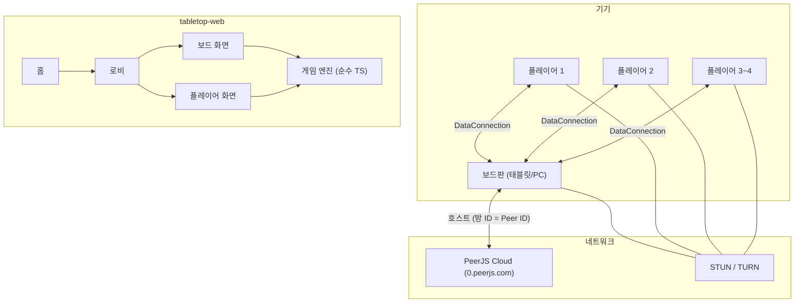
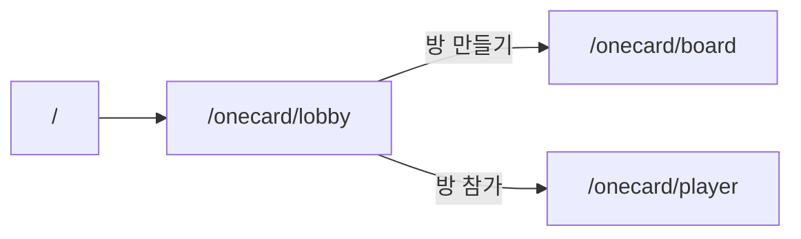
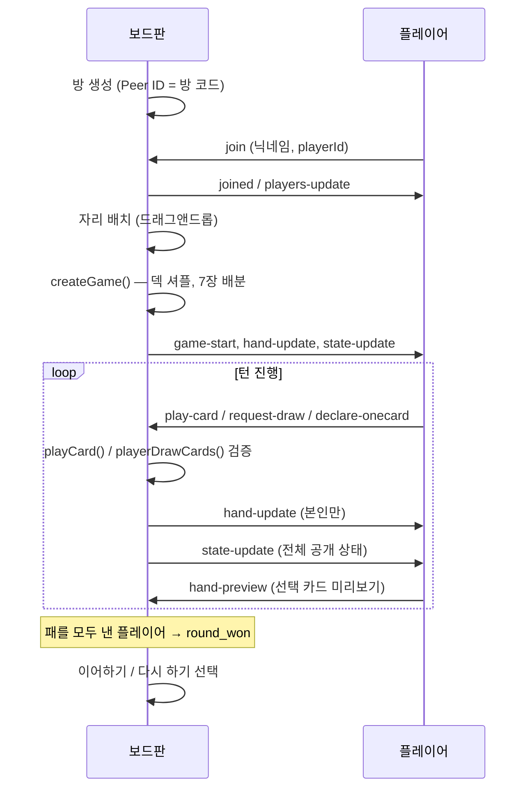

# Tabletop Web

여러 대의 기기(태블릿·스마트폰)로 함께 즐기는 **보드게임 시뮬레이터**입니다.  
현재 **원카드(One Card)** 를 지원하며, 보드판 1대 + 플레이어 2~4대가 P2P로 연결됩니다.

## 사용 기술

| 구분 | 기술 |
|------|------|
| 프레임워크 | [Vue 3](https://vuejs.org/) (Composition API, `<script setup>`) |
| 빌드 | [Vite 8](https://vite.dev/) |
| 언어 | TypeScript |
| 라우팅 | Vue Router 5 |
| 상태 관리 | Pinia |
| P2P 통신 | [PeerJS](https://peerjs.com/) (WebRTC DataChannel) |
| ICE | STUN + TURN (`openrelay.metered.ca` 기본, 자체 TURN 설정 가능) |

## 구성



- **보드판**: 방 생성·자리 배치·게임 시작·룰 검증·덱/버린 더미·상대 패 뒷면·카드 뽑기 버튼
- **플레이어**: 본인 패 조작(탭으로 확대/내기), 원카드 선언, 턴 표시
- **게임 로직**: `src/games/onecard/` 에 순수 함수로 분리 (UI·네트워크와 무관)

## 화면 흐름



| 경로 | 역할 | 설명 |
|------|------|------|
| `/` | 공통 | 게임 선택 (현재: 원카드) |
| `/onecard/lobby` | 공통 | 방 만들기 / 참가, 방 코드 표시 |
| `/onecard/board` | 보드판 전용 | 4모서리 테이블, 자리 배치, 게임 진행 |
| `/onecard/player` | 플레이어 전용 | 패 UI, 턴 표시 |

## 게임 진행 흐름



### 게임 단계 (`GamePhase`)

| 단계 | 설명 |
|------|------|
| `waiting` | 게임 시작 전 |
| `playing` | 진행 중 |
| `round_won` | 한 명이 패를 모두 냄 → 이어하기 / 다시 하기 선택 |
| `finished` | 최종 승자 확정 |
| `paused` | 플레이어 연결 끊김 등 |

### 자리 배치

보드판 기준 **시계 방향**: 아래 → 왼쪽 → 위 → 오른쪽  
턴 순서는 자리 배치와 동일합니다. 자리 배치 UI는 중앙 미배치 풀 + 모서리 슬롯 **드래그앤드롭**이며, occupied 자리에 놓으면 **서로 교체**됩니다.

## P2P 메시지

보드판이 **호스트(권한 서버)** 역할을 하며, 플레이어는 카드 내기·드로우 요청만 보냅니다.

| 메시지 | 방향 | 용도 |
|--------|------|------|
| `join` | P → B | 방 참가 |
| `joined` / `players-update` | B → P | 접속 확인·목록 갱신 |
| `play-card` | P → B | 카드 내기 |
| `request-draw` | P → B | 턴 중 드로우 |
| `declare-onecard` | P → B | 원카드 선언 |
| `hand-preview` | P → B | 선택 카드 미리보기 (보드 뒷면 강조) |
| `hand-update` | B → P | 본인 패 동기화 |
| `state-update` | B → * | 공개 게임 상태 (덱 수, 턴, 버린 더미 등) |
| `play-rejected` | B → P | 불가 행동 사유 |

## 프로젝트 구조

```
src/
├── views/
│   ├── HomeView.vue              # 홈
│   └── onecard/
│       ├── OneCardLobbyView.vue  # 로비
│       ├── OneCardBoardView.vue  # 보드판
│       └── OneCardPlayerView.vue # 플레이어
├── components/                   # 카드·패·덱·자리배치 UI
├── composables/
│   ├── usePeerRoom.ts            # PeerJS 방·게임 동기화
│   └── messages.ts               # P2P 메시지 타입
├── games/onecard/
│   ├── game.ts                   # 게임 상태·턴·승리 처리
│   ├── rules.ts                  # 카드 낼 수 있는지 판정
│   ├── deck.ts                   # 덱 생성·셔플
│   └── history.ts                # 턴 되돌리기
├── stores/roomStore.ts           # 연결·공개 상태·내 패
├── utils/
│   ├── boardLayout.ts            # 4모서리 자리·턴 순서
│   ├── session.ts                # sessionStorage / localStorage
│   └── clipboard.ts              # 방 코드 복사
└── config/peer.ts                # PeerJS·ICE 설정
```

## 시작하기

### 요구 사항

- Node.js `^22.18.0` 또는 `>=24.12.0`

### 설치 및 실행

```sh
npm install
npm run dev
```

같은 Wi-Fi에 연결된 기기에서 `http://<개발 PC IP>:5173` 으로 접속합니다.  
`npm run dev`는 `--host`로 실행되어 LAN 접속이 가능합니다.

### 빌드

```sh
npm run build    # 타입 체크 + 프로덕션 빌드
npm run preview  # 빌드 결과 미리보기
```

## 환경 변수 (선택)

자체 TURN 서버를 쓰려면 프로젝트 루트에 `.env` 를 추가합니다.

```env
VITE_TURN_URLS=turn:your.server:3478
VITE_TURN_USERNAME=your-username
VITE_TURN_CREDENTIAL=your-credential
```

미설정 시 `openrelay.metered.ca` 공개 TURN을 사용합니다.

## 브라우저

- **권장**: 최신 Chrome, Safari, Edge (모바일·태블릿 포함)
- **P2P**: WebRTC 지원 브라우저 필요. 방화벽·NAT 환경에서는 TURN 품질에 따라 연결이 달라질 수 있습니다.
- **구형 Safari**: 터치 진입·스크롤 이슈를 일부 완화했으나, iOS 12 이하 등 ES 모듈 미지원 환경은 빌드 타겟 추가(`@vitejs/plugin-legacy`)가 필요할 수 있습니다.

## CI (Gitea Actions)

`main` / `master` 브랜치에 push·PR 시 Gitea Runner(`ubuntu-latest`)에서 빌드를 실행합니다.

워크플로: [`.gitea/workflows/ci.yml`](.gitea/workflows/ci.yml)

```sh
npm ci
npm run build   # vue-tsc 타입 체크 + vite build
```

### Runner 요구 사항

1. Gitea 서버에서 **Actions** 활성화
2. `main-runner` 등 `ubuntu-latest` 레이블 러너 등록·유휴 상태
3. (선택) Actions 마켓플레이스 URL — `actions/checkout`, `actions/setup-node` 사용  
   자체 호스팅 Gitea는 `app.ini`에 `DEFAULT_ACTIONS_URL` 설정이 필요할 수 있습니다.

푸시 후 저장소 **Actions** 탭에서 `CI` 워크플로 실행 여부를 확인하세요.

## 라이선스

Private project.
